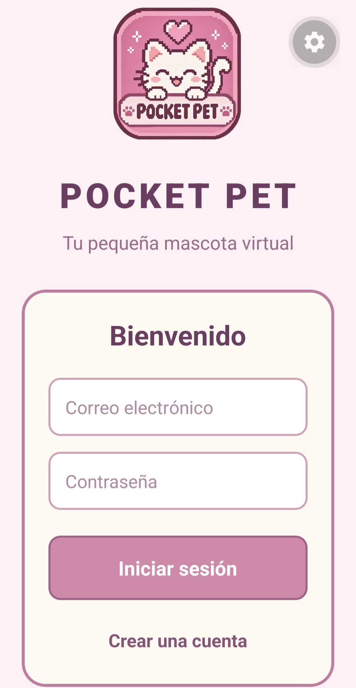
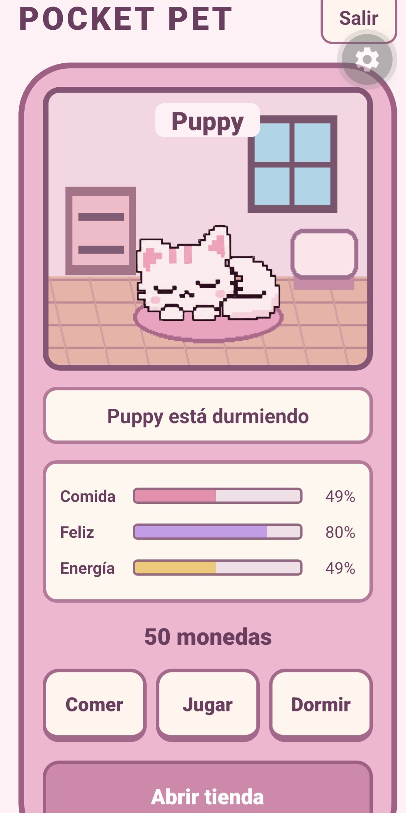
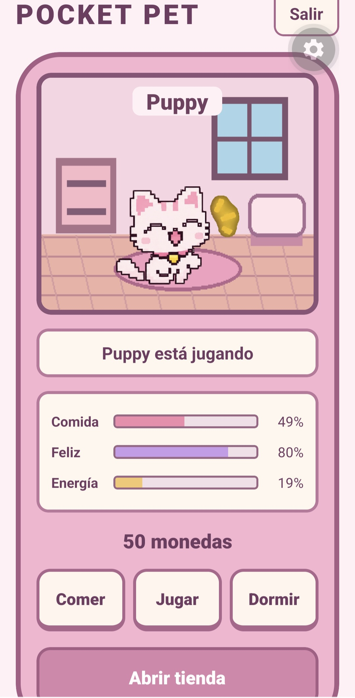
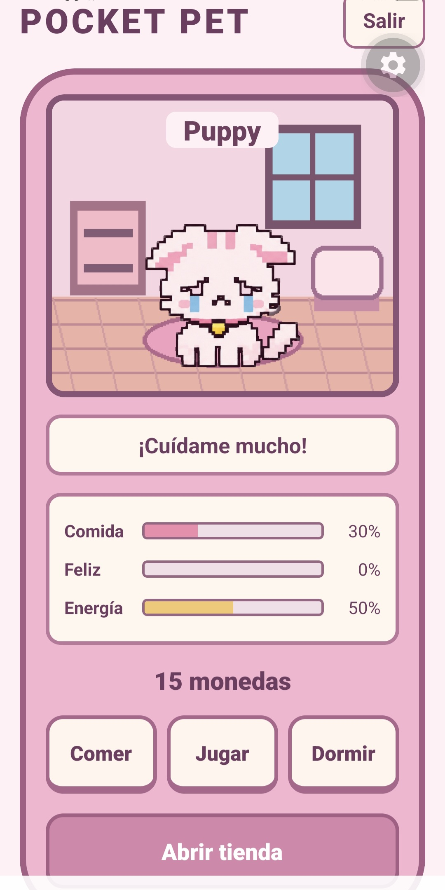
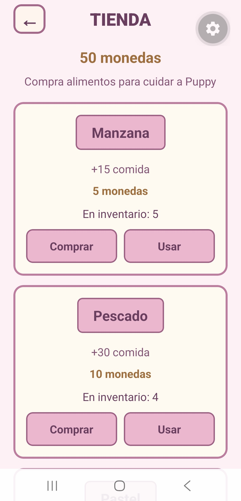

Mascota virtual inspirada en tamagotchi

Pocket Pet es una aplicación móvil de mascota virtual desarrollada con React Native, Expo y Firebase.

El objetivo del proyecto es crear una experiencia  en la que el usuario pueda adoptar una mascota, ponerle un nombre y cuidar de ella mediante diferentes acciones, como alimentarla, jugar y descansar.

La aplicación cuenta con un diseño inspirado en los videojuegos pixel art, utilizando una estética de colores pastel.

Tecnologías utilizadas

JavaScript

React Native

Expo

Firebase Authentication

Cloud Firestore

Git y GitHub

Funcionalidades:

Registro e inicio de sesión

Creación de cuentas mediante correo electrónico y contraseña.

Inicio de sesión de usuarios registrados.

Cierre de sesión.

Adopción de mascotas

Creación de una mascota virtual.

Personalización del nombre.

Diferentes expresiones de la mascota según sus acciones.

Cuidado de la mascota

Sistema de alimentación.

Sistema de felicidad.

Sistema de energía.

Disminución progresiva de las necesidades con el paso del tiempo.

Acciones para alimentar, jugar y descansar.

Tienda virtual

Sistema de monedas virtuales.

Compra de alimentos.

Inventario de productos.

Uso de los alimentos adquiridos para mejorar las necesidades de la mascota.

Persistencia de datos

Almacenamiento de la información de la mascota en Cloud Firestore.

Recuperación de los datos asociados a cada usuario.

Actualización de las estadísticas y del inventario.

## Capturas de pantalla

### Inicio de sesión

### Estados de la mascota

  
  
  

### Tienda

Instalación y ejecución

Para ejecutar el proyecto es necesario tener Node.js instalado.

Clonar el repositorio:

git clone https://github.com/anavportega-glitch/pocket-pet.git

Acceder a la carpeta del proyecto:

cd pocket-pet

Instalar las dependencias:

npm install

Configurar Firebase en src/services/firebase.js con un proyecto propio y habilitar Authentication y Cloud Firestore.

Iniciar Expo:

npx expo start

Abrir la aplicación desde Expo Go en un dispositivo compatible.

Objetivo del proyecto

Este proyecto ha sido desarrollado como práctica personal para aplicar y mejorar conocimientos de desarrollo de aplicaciones móviles, programación con JavaScript, gestión de estados, autenticación de usuarios y bases de datos en la nube.

Estado del proyecto

Primera versión funcional desarrollada. Se podrán incorporar nuevas funcionalidades y mejoras en futuras versiones.

Autora

Ana V.P Ortega

Proyecto personal de desarrollo de aplicaciones multiplataforma.